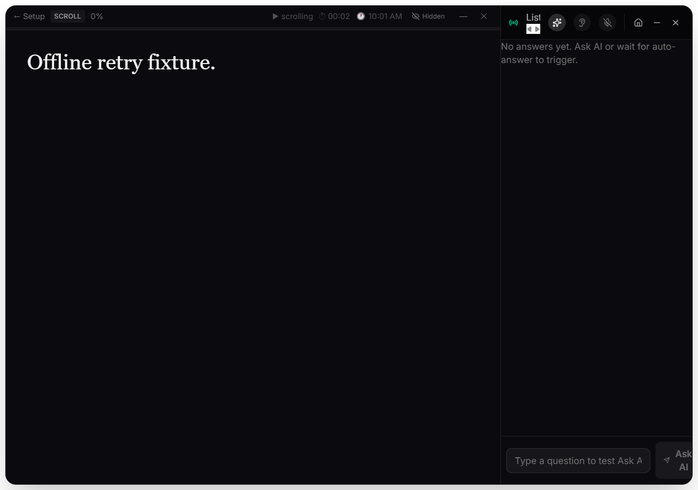

# Offline transcription acceptance

Historical checkpoint: the [lifecycle validation](lifecycle-report.md) adds CR-009 and supersedes the installer and test counts below. Consult the delivery register for the latest artifact checksum.

Date: 2026-09-16. Windows x64, Electron 43.4.1, Sarathi 1.8.0.

## Outcome

Real offline transcription and same-session Retry recovery passed. Validation uncovered **CR-008 (Medium/P2)**: a fresh worker's offline initialization error could prematurely fail a first-time model download. The fix initializes new download workers with downloads allowed, avoiding the competing initialization request.

- All three TypeScript projects pass; **38 regression tests pass**.
- Actual non-default model download/load passed after the fix.
- **4 offline checks passed**: cold-router fallback selection, speech transcription, backend restart, and recovery through the actual Retry button.
- **13 Electron smoke checks passed** after the fix.
- **8 packaged-runtime checks passed**, including native ONNX inference from the packaged worker.
- Windows installer rebuilt successfully.

The locally synthesized phrase was transcribed exactly in both runtimes:

> The project team will review the delivery schedule tomorrow morning. Please confirm the next meeting time.

The development final arrived 3,001 ms after buffered PCM submission. This single synthetic fixture does not establish general transcription accuracy or real-time performance.

## Latest artifact

`dist-installer/Sarathi Setup 1.8.0.exe`: **239,435,825 bytes**, **unsigned**.

```text
SHA-256: 5EF5DEF1CFDC295928D41DB77190B6DA072CCAA3813E49C8BA694E276A11DFEB
```

This supersedes the earlier installer checksum in the initial validation report. No installer publication or installation was performed in this acceptance step.

## Reproduction

From a Windows PowerShell session in the repository root:

```powershell
npm run build
./scripts/create-speech-fixture.ps1
node scripts/offline-stt-smoke.cjs --download
node scripts/offline-stt-smoke.cjs
npm run dist:win
node scripts/packaged-smoke.cjs --offline
```

The download step acquires the supported non-default `Xenova/whisper-small` model into `cache/offline-validation/models`. The application reported 251,875,316 downloaded bytes. Subsequent inference uses cached files with downloads disabled. Each app run uses a fresh isolated profile; normal user settings and credentials are not accessed.

The fixture generator uses local Windows speech synthesis, not a microphone or cloud service. The inference checks send synthetic 16 kHz mono PCM followed by silence through the real renderer-to-main STT IPC. The final UI recovery test uses the normal system-loopback startup path, then stops the backend and exits once recovery is verified.

## Evidence

- [First-time download failure before the fix](offline-download-before-fix.json)
- [Successful download after the fix](offline-download-results.json)
- [Offline inference and recovery results](offline-inference-results.json)
- [Post-fix Electron smoke results](electron-results-after-download-fix.json)
- [Packaged offline results](packaged-offline-results.json)

The real Retry button recovered into the local listening state and removed the startup error:



## Remaining limits

Native picker interaction, LibreOffice visual conversion, physical device/OS permission/keychain failures, representative speech/endurance testing, and install/upgrade/uninstall acceptance remain separate checks. Signing is not configured. The synthetic-speech result is not a release certification.

The [delivery register](../../../live_project_delivery_register.md) is the authoritative project memory.
