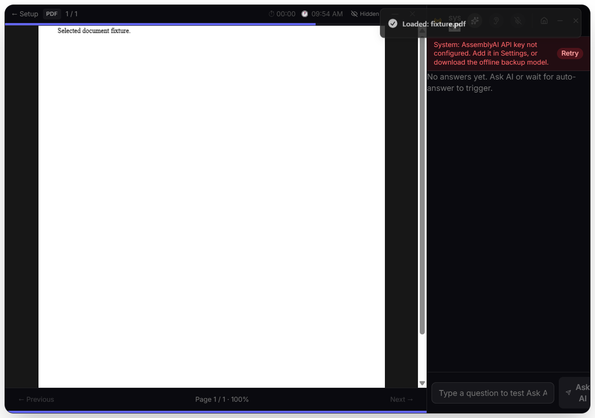
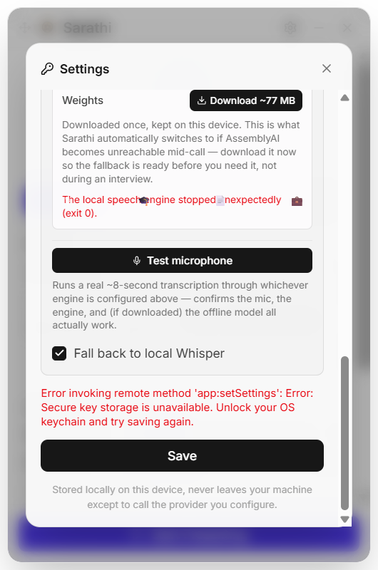

# Sarathi integration and packaging validation

Historical checkpoint: the installer checksum and 37-test/7-packaged-check counts below were superseded by the [offline acceptance report](offline-report.md), which includes the additional CR-008 fix and rebuilt artifact.

Date: 2026-09-16. Platform: Windows x64, Electron 43.4.1. Version: 1.8.0.

## Results

- 37 existing/regression tests passed in the remediation run; main, renderer and test type checks passed.
- **13 Electron integration checks passed**: see [machine-readable results](electron-results.json).
- **7 packaged-runtime checks passed**: see [machine-readable results](packaged-results.json).
- `npm run dist:win` completed successfully.
- The native installer opened its installation-options and destination screens. It was cancelled before installation, and its window closed.
- No test application processes were left running.

The generated installer is `dist-installer/Sarathi Setup 1.8.0.exe`, 239,435,958 bytes. It is **unsigned**. SHA-256:

```text
034DA6735E73AC2537B93B70932E1D22E9012648A1F88EFAB51B02F2DFD6268F
```

## Repeatable checks

Run from the repository root:

```powershell
npm run build
node scripts/electron-smoke.cjs
npm run dist:win
node scripts/packaged-smoke.cjs
```

The first smoke script launches real Electron with the production build, synthetic document fixtures, synthetic keys and a fresh profile. It tests the production IPC handlers, native Windows key encryption, real document parsing, PDF rendering, error/retry UI and actual speech-worker termination. It also briefly opens microphone and loopback tracks and loads the audio worklet, then releases all resources without recording or sending audio.

The second script launches the packaged `Sarathi.exe` with a fresh profile. It checks ASAR contents, renderer/preload startup, settings encryption, document access restrictions and STT configuration errors. It also boots the actual packaged speech worker through Electron's utility-process API with downloads disabled. Debugging connections are ephemeral and restricted to the spawned local test app.

Both scripts write reports into unique ignored `cache` directories and return nonzero on failed checks. The intentional unavailable-keychain check logs an expected IPC error; its success criterion is the displayed failure message.

## Evidence

The PDF page rendered and the initial STT error exposed Retry. Retrying with the configuration still missing retained the recovery action:



The real Settings renderer displayed the injected secure-storage-unavailable error:



## Verification limits

- The native document picker selection was injected; authorization and subsequent IPC/parsing/rendering were real.
- LibreOffice is absent. Formatted DOCX fallback passed; LibreOffice visual conversion was not tested.
- Windows key encryption passed; unavailable-keychain behavior was injected without locking the OS keychain.
- Actual mic/loopback acquisition and release passed. Physical disconnect/OS permission changes were not performed; startup rollback is covered by injected regression tests.
- No speech was recorded, no provider request was sent, and no model weights were downloaded. Cached-model inference and live successful transcription/retry remain acceptance checks.
- Setup screens and the unpacked packaged runtime were checked; install/upgrade/uninstall and trusted signing remain release checks.

The [delivery register](../../../live_project_delivery_register.md) holds the authoritative finding status and next actions.
