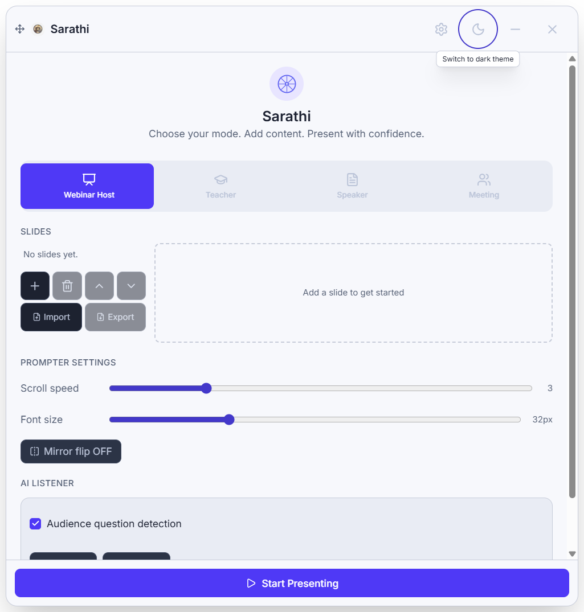
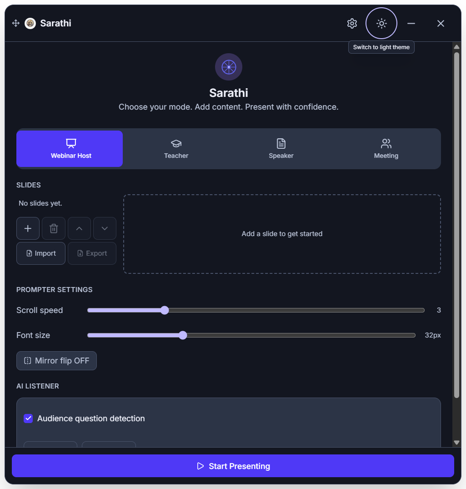
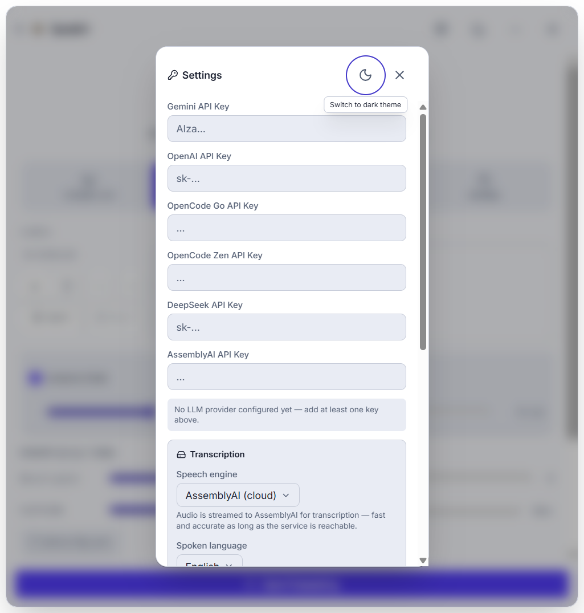
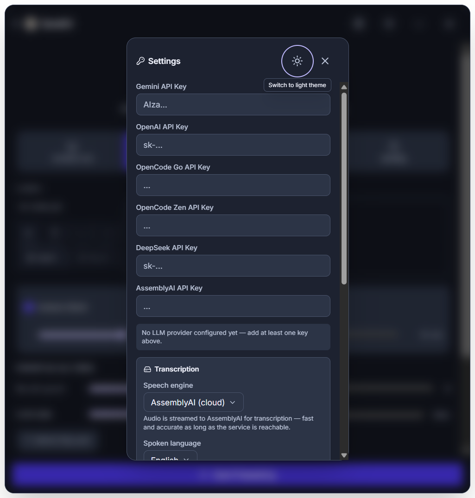
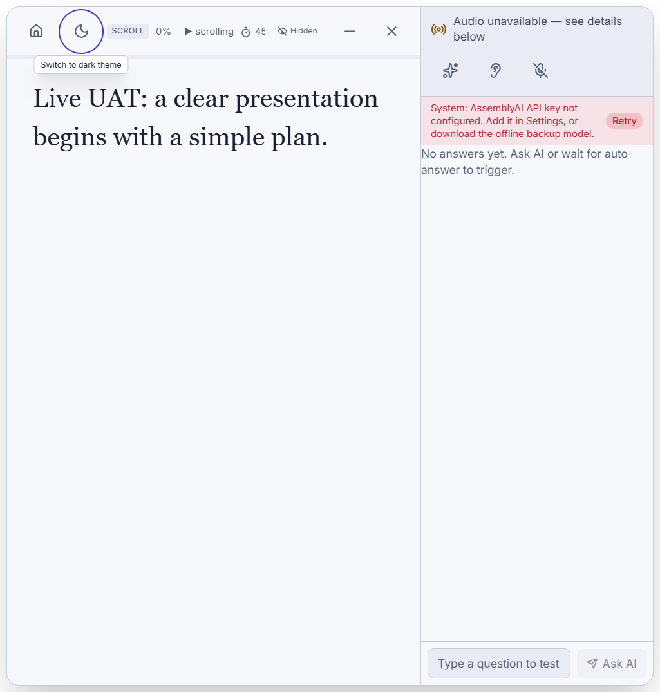
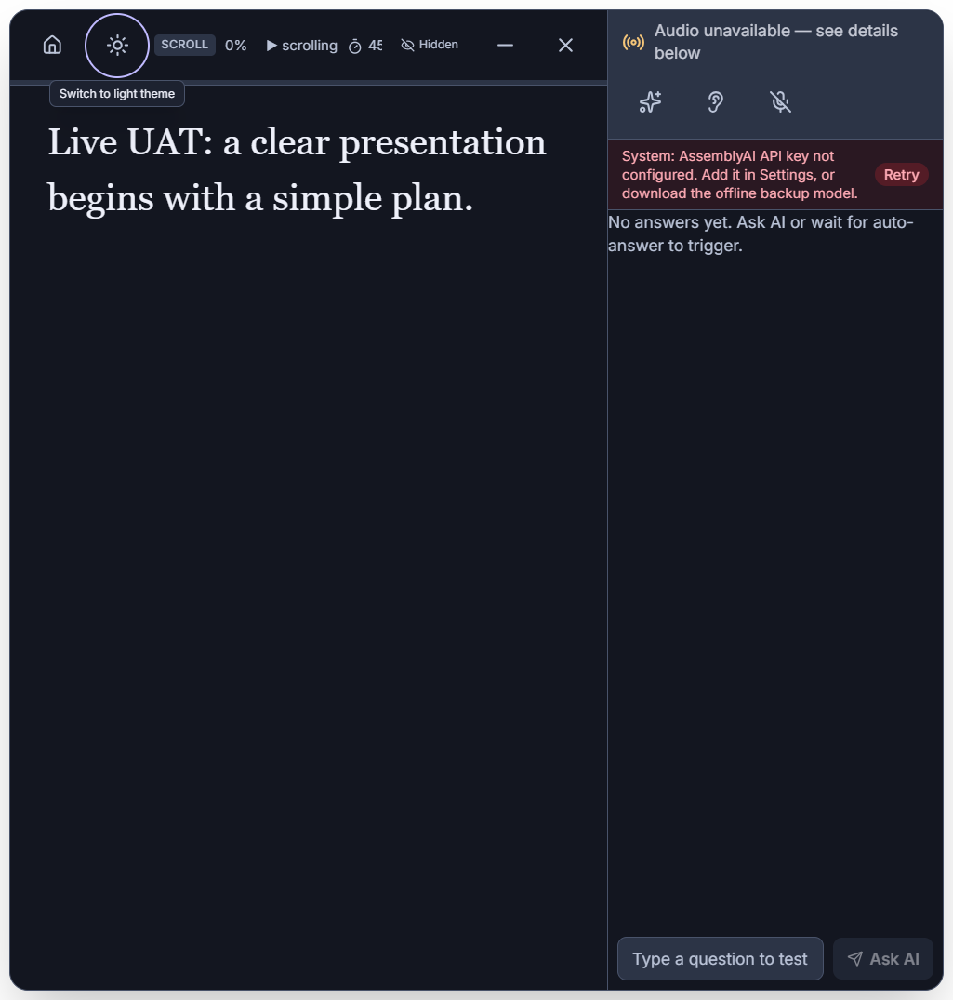

# UI/UX and theme acceptance — 2026-09-16

Owner: Codex. Agent-executed live UAT against the production Electron renderer, using isolated profiles and synthetic content. No human usability sign-off or Google certification is claimed.

## Delivered design

- One shared semantic palette for setup, Settings, documents, slides and presentation. Initial theme follows the OS; explicit light/dark preference persists locally across reloads.
- Sun/Moon control beside Settings on setup, beside Home in presentation, and inside Settings. Main navigation and transcription icon targets are 48 CSS pixels, with accessible names, selected states, focus outlines and tooltips.
- Consistent Lucide outlined action icons replace persona/timer emoji. Existing application logo and user asset changes are preserved. No extra icon dependency or remote font was added.
- All four persona labels remain visible at 360px. Slide editing stacks at narrow widths; presentation places the co-pilot panel below content. Secondary timer details hide in the narrow toolbar so navigation stays available.
- Keyboard-operable custom dropdowns, switch semantics, labeled API-key inputs, a Settings focus trap, Escape dismissal and focus restoration. Reduced-motion CSS is included.
- Semantic colors and interaction principles follow [Google Material 3 theming](https://developer.android.com/codelabs/m3-design-theming), [icon button guidance](https://m3.material.io/components/icon-buttons/guidelines) and [interaction states](https://m3.material.io/foundations/interaction/states/overview). This is a Material-informed desktop design using existing React components.

## Live UAT, one item at a time

| ID | Scenario | Result |
| --- | --- | --- |
| UAT-01 | UX-001 initial theme follows OS preference | PASS |
| UAT-02 | UX-001 light theme applies and persists through reload | PASS |
| UAT-03 | UX-001 light semantic text contrast is at least 4.5:1 | PASS |
| UAT-04 | UX-001 dark theme applies and persists through reload | PASS |
| UAT-05 | UX-001 dark semantic text contrast is at least 4.5:1 | PASS |
| UAT-06 | UX-002 keyboard activates 48px theme control beside Settings | PASS |
| UAT-07 | UX-002 four modes remain labeled and selectable at 360px | PASS |
| UAT-08 | UX-002 slide creation, teacher timer and mirror controls work | PASS |
| UAT-09 | UX-003 light Settings labels, focus trap and Escape | PASS |
| UAT-10 | UX-003 dark Settings labels, focus trap and Escape | PASS |
| UAT-11 | UX-003 dropdown supports arrows, Enter and focus return | PASS |
| UAT-12 | UX-004 presentation preserves content while switching both themes | PASS |

[Machine-readable results](results.json). Reproduce after `npm run build` with `node scripts/ui-uat.cjs`.

The contrast check covers primary/secondary text, accent and semantic status text against both base and surface roles, at a minimum 4.5:1 in both themes. It is not a comprehensive WCAG audit of every composited state, document or legacy modal. Keyboard tests use Electron input events; native file dialogs are outside this suite. At 360px, the test explicitly verifies the actual viewport width, not just the requested window size.

## Issues found and resolved during UAT

- Settings shared z-index 10 with persona buttons, allowing them to paint over the dialog. Raised modal stacking to 50; subsequent screenshots verified the correction.
- Presentation text/status and Ask AI controls were cramped. Removed duplicate navigation from the transcript strip, gave status its own row, added input shrink bounds, and stacked the co-pilot panel on narrow windows.
- Early harness assertions were invalid: CSS shortened white to #fff but the contrast helper accepted only six digits; Enter injection omitted the character event; native minimum size prevented the requested narrow viewport. Corrected these before reporting passing acceptance. A later slide-test selector had a quoting error, corrected with no application change. The initial implementation also briefly failed compilation due to a selector-edit typo; corrected before UAT.

## Other validation and limits

- TypeScript main, renderer and tests: PASS.
- Existing automated suite: 42/42 PASS.
- Real Electron integration: 20/20 PASS ([results](electron-results.json)), including PDF rendering, failed document replacement recovery and Retry.
- PDF page contents retain their original appearance; the surrounding application chrome follows the selected theme.
- No cloud LLM request or personal audio fixture was used. Existing integration checks briefly acquire/release audio devices. Native-picker interaction, LibreOffice conversion, physical device failure, installation lifecycle and signing remain separately tracked acceptance work.

## Screenshots inspected

| Light | Dark |
| --- | --- |
|  |  |
|  |  |
|  |  |

[Compact setup](setup-narrow.png) · [Compact teacher mode](teacher-narrow.png) · [Compact presentation](presentation-narrow.png)

## Packaged delivery

Windows NSIS build passed. Updated installer: `dist-installer/Sarathi Setup 1.8.0.exe`, 239,438,441 bytes. SHA-256: `6D5E30991803CD20FE446F19762F53E409D8DEBF7EAC1C7125FE91877F29AD5F`. Authenticode status: NotSigned. This supersedes the document acceptance build; it was not installed or published.

Packaged acceptance passed **10/10**, including explicit switching/saving of both themes, safeStorage, document authorization and offline speech/stop lifecycle ([results](packaged-results.json)). An initial test incorrectly expected a saved preference before the user had changed the OS-derived default; corrected the harness to explicitly switch before checking persistence ([initial evidence](packaged-initial-results.json)). No application change was needed for that assertion.

Final diff whitespace check passed. Compiler-generated build-info files were restored. No Sarathi test process remained; unrelated applications were left running.
